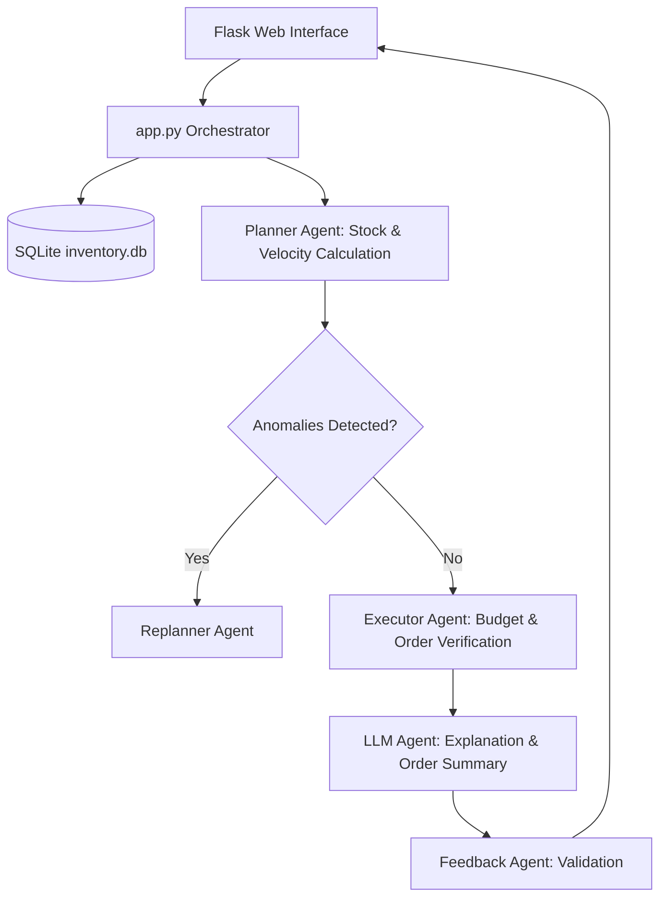

# Smart Inventory Planning Assistant (Multi-Agent AI System)

An autonomous multi-agent inventory optimization system built for small retail businesses, employing a **Planner Pattern** and LLMs to eliminate manual stock errors, under-stocking, and over-stocking.

## 📌 Problem Statement
Small brick-and-mortar retail shops frequently face financial losses due to manual inventory estimation. This project provides an autonomous AI assistant that analyzes historical sales, current stock levels, and supplier lead times to accurately determine:
1. **What** items to restock.
2. **How much** inventory to order.
3. **When** to trigger restock orders.

## 🚀 Key Features
- **Multi-Agent Architecture:** Specialized autonomous agents collaborating via structured message passing.
  - **Planner Agent:** Computes daily sales velocity and generates prioritized replenishment orders.
  - **Executor Agent:** Validates orders against budget constraints and simulates database updates.
  - **Feedback Agent:** Evaluates system accuracy and identifies stock deviations.
  - **Replanner Agent:** Dynamically recalculates orders upon stock anomalies or budget changes.
  - **LLM Agent:** Generates natural language reasoning and vendor communication summaries.
- **Dual Operating Modes:** Operates both in offline rule-based mode and online LLM-augmented mode.
- **Web UI & Database:** Flask interface connected to a SQLite database (`inventory.db`).
- **Complete Verification:** Includes full academic project report and end-to-end demo video (`DEMO VIDEO.mp4`).

## 🏗️ System Architecture


## 📂 Repository Structure
```
Agentic_AI_Project/
├── DEMO VIDEO.mp4                           # Complete recorded application walkthrough
├── Final_Report_of_Agentic_AI_Project.pdf   # Academic project report (Alliance University)
├── Smart_Inventory_Planning_System/
│   ├── app.py                              # Flask Web Server
│   ├── inventory.py                        # Inventory business logic & schema
│   ├── inventory.db                        # SQLite database
│   ├── agents/
│   │   ├── planner_agent.py                # Restock planning algorithm
│   │   ├── executor_agent.py               # Order execution & validation
│   │   ├── feedback_agent.py               # Accuracy verification
│   │   ├── replanner_agent.py              # Dynamic fallback replanning
│   │   └── llm_agent.py                    # LLM reasoning generator
│   └── templates/
│       ├── index.html                      # Dashboard UI
│       └── actions_result.html             # Agent output view
└── README.md
```

## ⚙️ Installation & Setup
1. **Clone repository:**
   ```bash
   git clone https://github.com/Bhumikaravi/Agentic_AI_Project.git
   cd Agentic_AI_Project/Smart_Inventory_Planning_System
   ```
2. **Install requirements:**
   ```bash
   pip install flask
   ```
3. **Launch application:**
   ```bash
   python app.py
   ```
4. Open your browser and navigate to `http://127.0.0.1:5000` to interact with the multi-agent system.

## 👩‍💻 Contributors
- **Bhumika R** & **Prakruthi BR**  
- Bachelor of Computer Applications (BCA), Alliance University, Bengaluru.
