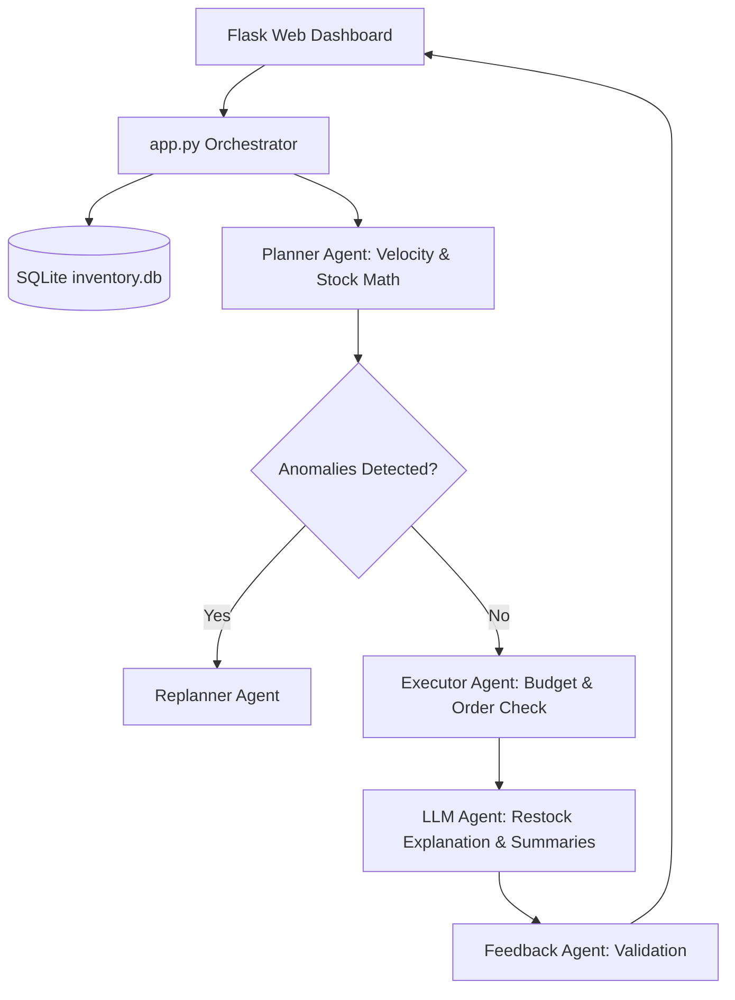

<p align="center">
  
</p>

<p align="center">
      
</p>


## 📌 Table of Contents
- [📖 Executive Summary](#-executive-summary)
- [✨ Key Features & Capabilities](#-key-features--capabilities)
- [🏗️ System Architecture & Workflow](#️-system-architecture--workflow)
- [🛠️ Tech Stack Breakdown](#️-tech-stack-breakdown)
- [⚙️ Reproducible Quickstart & Setup](#️-reproducible-quickstart--setup)
- [📂 Project Directory Layout](#-project-directory-layout)
- [👩‍💻 Author & Contributions](#-author--contributions)

---

## 📖 Executive Summary
### Problem Statement
Small and medium brick-and-mortar retailers suffer significant financial losses annually due to manual stock estimation. Inaccurate replenishment triggers either costly stockouts (lost revenue) or dead overstock (blocked working capital).

### Motivation & Solution Overview
The Smart Inventory Planning Assistant automates store replenishment using an intelligent Multi-Agent workflow built around the **Planner Pattern**. Specialized autonomous agents calculate sales velocity, enforce budget constraints, handle stock anomalies, and generate natural-language restocking justifications via local LLM reasoning.

---

## ✨ Key Features & Capabilities
- **Multi-Agent Coordination:** Orchestrates 5 specialized agents collaborating via typed message passing:
  - **Planner Agent:** Calculates daily sales velocity and generates prioritized restocking proposals.
  - **Executor Agent:** Validates replenishment orders against store budget limits and commits database updates.
  - **Feedback Agent:** Evaluates system accuracy and identifies stock deviations.
  - **Replanner Agent:** Dynamically recalibrates replenishment quantities when supply anomalies arise.
  - **LLM Agent:** Generates natural language reasoning and vendor replenishment summaries.
- **Dual Operating Modes:** Operates in offline rule-based mode and online LLM-augmented mode.
- **Responsive Dashboard:** Flask web interface displaying real-time inventory levels, replenishment tables, and agent decisions.
- **Academic Verification:** Verified capstone project at Alliance University accompanied by full project report and recorded video demo.

---

## 🏗️ System Architecture & Workflow


---

## 🛠️ Tech Stack Breakdown
| Layer | Technologies |
|---|---|
| **Programming Language** | Python 3.10+ |
| **Agent Framework** | Custom Multi-Agent Architecture (Planner Pattern) |
| **Web & Backend** | Flask, Jinja2 Templates, HTML5/CSS3 |
| **Database & Persistence** | SQLite (`inventory.db`) |
| **LLM Integration** | Local Open-Source LLM (Ollama / Llama) |
| **Documentation & Assets** | Architecture Report (PDF), Demonstration Video (MP4) |

---

## ⚙️ Reproducible Quickstart & Setup
### Prerequisites
- Python 3.10 or higher
- Git

### Installation Steps
```bash
# 1. Clone the repository
git clone https://github.com/Bhumikaravi/Agentic_AI_Project.git
cd Agentic_AI_Project/Smart_Inventory_Planning_System

# 2. Set up virtual environment
python -m venv .venv
# On Windows:
.venv\Scripts\activate
# On Linux/macOS:
source .venv/bin/activate

# 3. Install dependencies
pip install flask

# 4. Launch the application
python app.py
```
Open `http://127.0.0.1:5000` in your browser to interact with the multi-agent dashboard.

---

## 📂 Project Directory Layout
```text
Agentic_AI_Project/
├── DEMO VIDEO.mp4                           # Complete recorded walkthrough
├── Final_Report_of_Agentic_AI_Project.pdf   # Academic project report (Alliance University)
├── LICENSE                                  # MIT License
├── Smart_Inventory_Planning_System/
│   ├── app.py                              # Flask Web Server & Orchestrator
│   ├── inventory.py                        # Inventory business logic & schema
│   ├── inventory.db                        # SQLite database
│   ├── agents/
│   │   ├── planner_agent.py                # Restock planning algorithm
│   │   ├── executor_agent.py               # Order execution & validation
│   │   ├── feedback_agent.py               # Accuracy verification
│   │   ├── replanner_agent.py              # Dynamic fallback replanning
│   │   └── llm_agent.py                    # LLM reasoning generator
│   └── templates/
│       ├── index.html                      # Dashboard UI
│       └── actions_result.html             # Agent output view
└── README.md
```

---

## 👩‍💻 Author & Contributions
Developed by **Bhumika Ravi** ([@Bhumikaravi](https://github.com/Bhumikaravi)), Bachelor of Computer Applications (BCA) at **Alliance University, Bengaluru**.

- 💻 **GitHub Profile:** [github.com/Bhumikaravi](https://github.com/Bhumikaravi)
- 🔗 **LinkedIn:** [linkedin.com/in/bhumika-ravi-b5a01b326](https://www.linkedin.com/in/bhumika-ravi-b5a01b326/)
- 📬 **Email Contact:** [bhumikaravi2006@gmail.com](mailto:bhumikaravi2006@gmail.com)

---

<p align="center">
  
</p>
